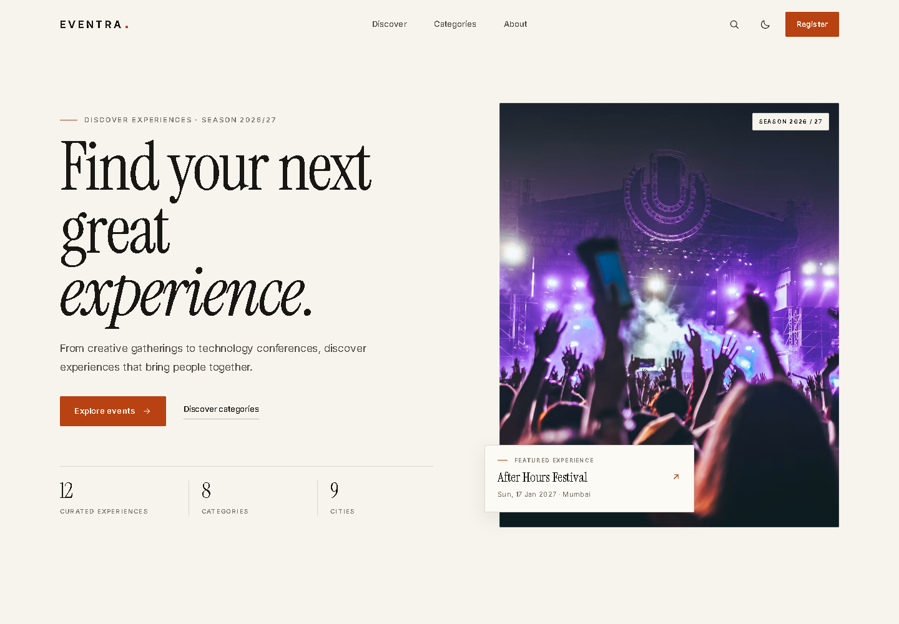
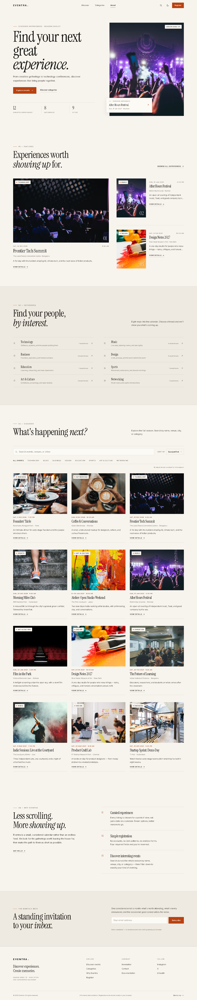
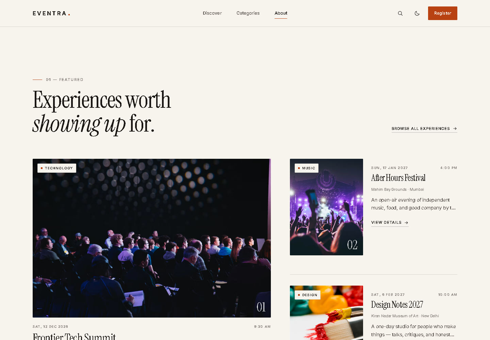
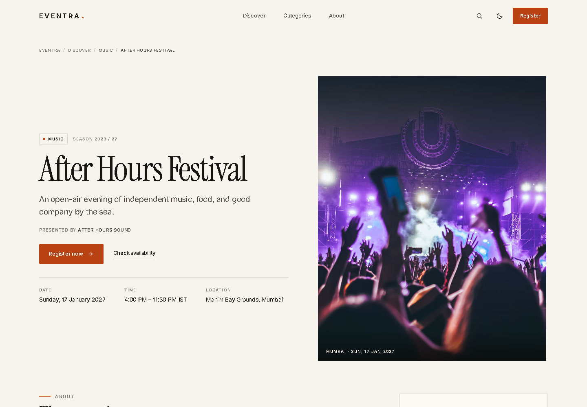
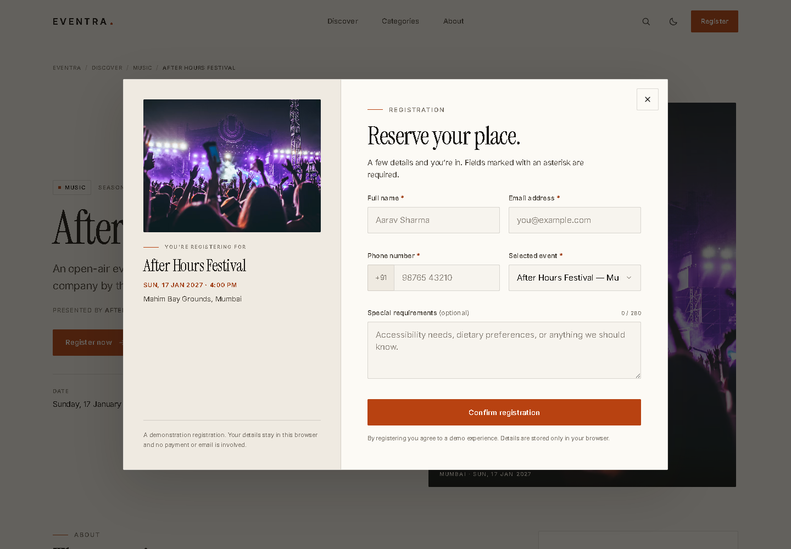
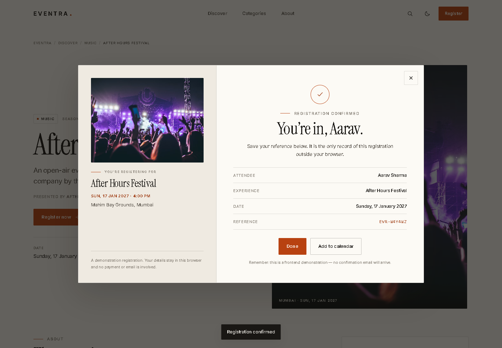
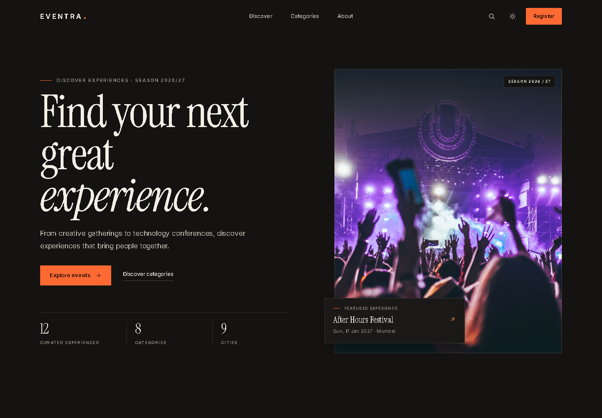
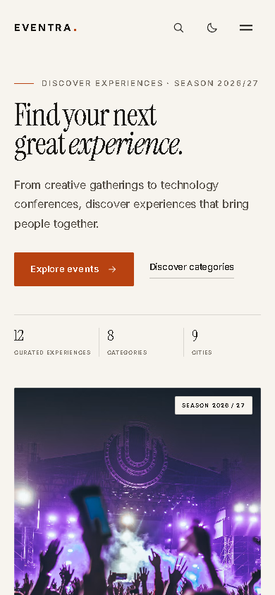
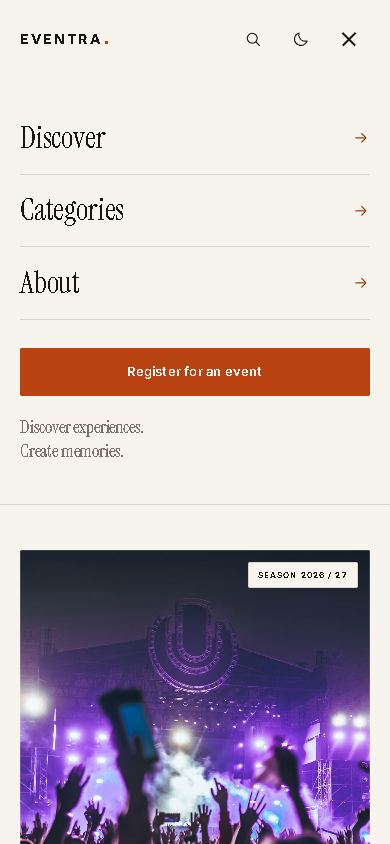
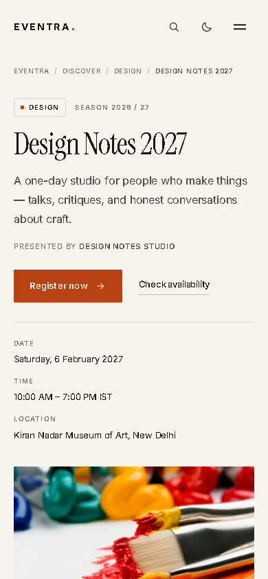

# EVENTRA

**Discover experiences. Create memories.**

EVENTRA is a premium, editorial event discovery and registration platform built with semantic HTML5, modern CSS, and vanilla JavaScript. It combines a curated event calendar, live search and category filtering, dynamic event pages, a validated registration flow, persistent browser storage, and a fully designed dark/light theme.

The project was built for the K Explore Web Designing event management task and is structured as a static site that can be published on GitHub Pages, Netlify, or any static host.

> **Demo notice:** This is a front-end demonstration. Registrations and newsletter sign-ups remain in the browser. No data is sent to a server, no confirmation email is delivered, and no payment is processed.

## Contents

- [Project overview](#project-overview)
- [Highlights](#highlights)
- [Technology](#technology)
- [Design system](#design-system)
- [Architecture](#architecture)
- [Project structure](#project-structure)
- [File reference](#file-reference)
- [Event data](#event-data)
- [Registration and storage](#registration-and-storage)
- [Running locally](#running-locally)
- [Testing](#testing)
- [Screenshots](#screenshots)
- [Deployment](#deployment)
- [Customisation](#customisation)
- [Accessibility](#accessibility)
- [Browser support](#browser-support)
- [Troubleshooting](#troubleshooting)
- [Limitations](#limitations)
- [Future improvements](#future-improvements)
- [Author](#author)
- [Credits](#credits)

## Project overview

Eventra is designed as a small, considered calendar rather than an endless feed. The season contains twelve events across eight categories and nine Indian cities, each presented through editorial photography, strong typography, and concise event information.

The experience covers three core journeys:

1. **Discover** — browse featured experiences, scan the category index, or search and filter the full calendar.
2. **Evaluate** — open an event page with the complete programme, venue details, countdown, and related experiences.
3. **Register** — reserve a place through a focused modal, receive a local confirmation and reference ID, and add the event to a calendar.

The visual language is warm minimalism: an off-white canvas, charcoal type, a single burnt-orange accent, Instrument Serif display headings, Inter interface text, thin rules, two-pixel radii, and generous whitespace.

## Highlights

### Homepage and discovery

- Twelve realistic events across Technology, Music, Business, Design, Education, Sports, Art & Culture, and Networking.
- Editorial hero with a featured experience card and live season statistics.
- Asymmetric featured section with one lead story and two compact stories.
- Category index with per-category counts and direct filtering.
- Live search across event title, venue, address, city, category, excerpt, and host.
- Category filter chips, sort controls, a live result count, and clear-filters actions.
- Combined search and category filtering with a designed empty state.
- Responsive event cards generated from a single dataset.

### Event details

- Dedicated `event.html?id=<event-id>` route with dynamic document metadata.
- Cover image, category, title, date, time, venue, address, description, expectations, and highlights.
- Countdown that updates every second until the event starts.
- Registration availability states for upcoming, live, and concluded events.
- Purpose-designed not-found state for invalid event IDs.
- Related events selected by category and date.
- Structured data (`schema.org/Event`) injected for the current event.
- Actions for Google Maps, copy link, and `.ics` calendar download.

### Registration

- Accessible modal shared by both pages.
- Required fields: full name, email, Indian mobile number, and selected event.
- Optional special-requirements note with a 280-character counter.
- Unicode-aware name validation, email validation, Indian mobile validation, and event availability validation.
- Inline error messages associated with their fields, invalid-field focus management, and blocking of invalid submissions.
- Duplicate prevention using event ID plus case-insensitive email.
- Unique reference ID in the `EVR-XXXXXX` format.
- Confirmation screen with attendee, event, date, and reference details.
- Add-to-calendar action on the confirmation screen.
- Registration records persist under `eventra:registrations:v1`.
- Focus trap, initial focus, Escape close, backdrop close, scroll lock, and focus restoration.

### Theme, motion, and accessibility

- Light theme by default, with a complete dark palette.
- Theme choice stored under `eventra:theme`, applied before first paint, and synchronised across tabs.
- Intersection Observer reveal animations with staggered event cards.
- Subtle hover transitions, image zooms, modal transitions, and mobile navigation animation.
- Full `prefers-reduced-motion` fallback.
- Semantic landmarks, skip link, visible focus styles, keyboard-operable controls, labelled form fields, and `aria-live` feedback.
- Local SVG image fallback if a remote photograph fails.
- No horizontal overflow from 320 px through wide desktop.

## Technology

| Area | Implementation |
| --- | --- |
| Markup | HTML5 with semantic landmarks and accessible ARIA where needed |
| Styling | CSS3, custom properties, Grid, Flexbox, `clamp()`, responsive media queries |
| Scripting | JavaScript ES6+, classic deferred scripts, one `window.Eventra` namespace |
| Event data | Structured JavaScript objects in `js/events.js` |
| Persistence | Web Storage API (`localStorage`) |
| Typography | Google Fonts: Instrument Serif and Inter |
| Photography | Unsplash URLs, plus `assets/images/fallback.svg` |
| Icons | Hand-authored inline SVG; no icon dependency |
| Build tooling | None required |
| Runtime dependencies | None |

Scripts load in dependency order with `defer`, so the HTML is parsed before behaviour initialises:

```text
events.js -> utils.js -> ui.js -> theme.js -> registration.js -> app.js
                                                 \-> event-details.js (event page)
```

## Design system

Design tokens live at the top of `css/style.css`.

### Colour

| Token | Light | Dark | Use |
| --- | --- | --- | --- |
| `--bg` | `#f7f4ee` | `#141311` | Page canvas |
| `--bg-elevated` | `#fcfaf5` | `#1b1917` | Inputs, panels, modal |
| `--surface` | `#efeae1` | `#201e1b` | Recessed surfaces |
| `--surface-strong` | `#e7e0d4` | `#282521` | Image placeholders |
| `--text` | `#191714` | `#f3efe7` | Primary type |
| `--text-soft` | `#514b43` | `#c9c3b8` | Body copy |
| `--muted` | `#7b746a` | `#9b9489` | Metadata |
| `--accent` | `#b84211` | `#ff6a33` | Calls to action |
| `--accent-hover` | `#953309` | `#ff8458` | Hover states |
| `--accent-ink` | `#9e3a10` | `#ff8a60` | Accent text and links |
| `--line` | 14% charcoal | 13% warm white | Borders and rules |

### Typography

- Display: Instrument Serif, regular and italic.
- Interface: Inter, weights 400–700.
- Monospace: local system stack, used only for reference IDs.
- Display headings use balanced wrapping (`text-wrap: balance`) and tight leading.
- Section and navigation labels use small uppercase tracking.

### Layout and shape

- Maximum content width: `78rem`.
- Page gutter: `clamp(1.25rem, 4vw, 3rem)`.
- Header height: `4.875rem`.
- Section rhythm: `clamp(4.5rem, 9vw, 8.5rem)`.
- Corner radius: `2px`.
- Shadows are reserved for floating cards and the modal.

### Motion

- Standard easing: `cubic-bezier(0.22, 0.61, 0.36, 1)`.
- Exit/entry easing: `cubic-bezier(0.16, 1, 0.3, 1)`.
- Reveals are short, staggered, and disabled when reduced motion is requested.

## Architecture

Eventra is a multi-page static application with a shared runtime:

- `js/events.js` defines categories and events as plain data.
- `js/utils.js` contains pure helpers for IST date formatting, event status, sorting, escaping, countdowns, ICS export, clipboard access, and storage-safe querying.
- `js/ui.js` owns markup builders and shared interface behaviour, including header state, mobile navigation, scroll spy, reveal observation, image failure handling, toast notifications, and calendar/copy delegation.
- `js/theme-init.js` runs synchronously in the document head to set the saved theme before paint.
- `js/theme.js` handles interactive theme changes and cross-tab synchronisation.
- `js/registration.js` builds the modal once, manages validation and persistence, and exposes a small public API.
- `js/app.js` renders the homepage and owns discovery state.
- `js/event-details.js` reads the query parameter, populates the detail page, starts the countdown, and handles invalid IDs.

Both pages share the same header, mobile navigation, footer, modal, theme, and utility layer. The event dataset is the single source of truth; no event markup is duplicated in HTML.

### URL routes

| URL | Purpose |
| --- | --- |
| `/index.html` | Homepage and discovery |
| `/event.html?id=after-hours-festival` | Dynamic event detail page |
| `/event.html?id=missing-id` | Designed not-found state |

Event IDs are URL-encoded before use.

## Project structure

```text
eventra/
├── index.html
├── event.html
├── css/
│   ├── style.css
│   ├── components.css
│   ├── event.css
│   └── responsive.css
├── js/
│   ├── events.js
│   ├── utils.js
│   ├── ui.js
│   ├── theme-init.js
│   ├── theme.js
│   ├── registration.js
│   ├── app.js
│   └── event-details.js
├── assets/
│   ├── favicon.svg
│   └── images/
│       └── fallback.svg
├── docs/
│   └── screenshots/
├── README.md
└── .gitignore
```

## File reference

| File | Responsibility |
| --- | --- |
| `index.html` | Homepage markup: hero, featured section, category index, discovery controls, about, newsletter, footer |
| `event.html` | Detail-page shells for the event view, not-found state, registration panel, and related events |
| `css/style.css` | Design tokens, base reset, typography, shared atoms, header, mobile navigation, footer, reveal system, toast |
| `css/components.css` | Hero, featured cards, category rows, discovery toolbar, event cards, newsletter, empty state, registration modal |
| `css/event.css` | Event hero, breadcrumb, metadata, cover, registration card, countdown, detail sections, venue card, related events, not-found |
| `css/responsive.css` | Tablet and phone composition, mobile navigation, modal reflow, overflow prevention, reduced motion |
| `js/events.js` | Eight categories and twelve events, including descriptions, expectations, highlights, hosts, and imagery |
| `js/utils.js` | Date and time formatting in IST, event status, registration checks, escaping, sorting, countdown, ICS, clipboard, DOM helpers |
| `js/ui.js` | Shared icon and card markup, header behaviour, scroll spy, reveal observer, image fallback, toasts, footer year |
| `js/theme-init.js` | Pre-paint theme restoration and `js` class |
| `js/theme.js` | Theme toggle, persistence, metadata colour, cross-tab sync |
| `js/registration.js` | Modal construction, event options, validation, duplicate checks, storage, confirmation, focus management |
| `js/app.js` | Hero/featured/category rendering, search, filters, sorting, results, empty state, newsletter feedback |
| `js/event-details.js` | Query-string loading, page population, countdown, related events, metadata, structured data, not-found state |
| `assets/favicon.svg` | Typographic accent mark favicon |
| `assets/images/fallback.svg` | Local fallback for failed remote images |

## Event data

Events live in `js/events.js` as an array. Each object uses this shape:

```javascript
{
  id: 'after-hours-festival',       // URL-safe unique identifier
  title: 'After Hours Festival',
  category: 'Music',
  featured: true,                   // optional editorial flag
  hero: true,                       // optional homepage hero flag
  date: '2027-01-17T16:00:00+05:30',// ISO 8601 with IST offset
  endDate: '2027-01-17T23:30:00+05:30',
  venue: 'Mahim Bay Grounds',
  address: 'Mahim Causeway, Dharavi',
  city: 'Mumbai',
  image: 'https://images.unsplash.com/...',
  imageAlt: 'Descriptive alternative text',
  excerpt: 'Short listing description.',
  description: ['Full paragraph one.', 'Full paragraph two.'],
  expect: ['What attendees can expect'],
  highlights: ['Short highlight'],
  host: 'After Hours Sound'
}
```

The dataset currently contains:

| Event | Category | City | Date |
| --- | --- | --- | --- |
| Founders' Table | Business | Pune | 5 Dec 2026 |
| Coffee & Conversations | Networking | Mumbai | 6 Dec 2026 |
| Frontier Tech Summit | Technology | Bengaluru | 12 Dec 2026 |
| Morning Miles Club | Sports | Hyderabad | 20 Dec 2026 |
| Atelier: Open Studio Weekend | Art & Culture | Jaipur | 9–10 Jan 2027 |
| After Hours Festival | Music | Mumbai | 17 Jan 2027 |
| Film in the Park | Art & Culture | Kolkata | 24 Jan 2027 |
| Design Notes 2027 | Design | New Delhi | 6 Feb 2027 |
| The Future of Learning | Education | Bengaluru | 20 Feb 2027 |
| Indie Sessions: Live at the Courtyard | Music | Goa | 6 Mar 2027 |
| Product Craft Lab | Design | Chennai | 20 Mar 2027 |
| Startup Sprint: Demo Day | Business | Hyderabad | 10 Apr 2027 |

Search and sorting are applied to this data at runtime. Category counts are derived rather than hard-coded.

## Registration and storage

Registrations are stored under the key `eventra:registrations:v1`.

```json
[
  {
    "id": "EVR-7K2M9Q",
    "eventId": "after-hours-festival",
    "name": "Aarav Sharma",
    "email": "aarav@example.com",
    "phone": "+91 98765 43210",
    "notes": "Front-row access if available.",
    "createdAt": "2026-11-02T13:15:18.295Z"
  }
]
```

### Validation rules

| Field | Rule |
| --- | --- |
| Name | Required; 2–80 characters; Unicode letters, marks, spaces, apostrophes, periods, or hyphens |
| Email | Required; `name@example.com` format with a valid local part, domain, and 2+ character suffix |
| Phone | Required; accepts spaces, hyphens, `+91`, or a leading 0; normalises to a 10-digit Indian mobile starting 6–9 |
| Event | Required; must exist in the dataset and still be open for registration |
| Notes | Optional; limited to 280 characters |

The phone field displays a fixed `+91` prefix and stores the formatted value. The form is marked `novalidate` so the custom accessible validation, rather than browser bubbles, controls feedback.

### Duplicate policy

A registration is considered a duplicate when both the event ID and the case-insensitive email match an existing record. Duplicate attempts keep the modal open, focus the email field, and display an inline error plus an alert.

### Reference IDs

References use the alphabet `ABCDEFGHJKLMNPQRSTUVWXYZ23456789`, excluding ambiguous characters. A six-character suffix is generated, checked against existing records, and prefixed with `EVR-`.

### Privacy and limits

- No network request is made with registration data.
- Notes are stored but never rendered as HTML.
- Clearing browser site data removes registrations and saved preferences.
- Storage writes are wrapped in `try/catch`; the interface reports a clear error if storage is blocked.
- This implementation does not represent a real ticketing or email system.

Inspect demo data from DevTools:

```javascript
JSON.parse(localStorage.getItem('eventra:registrations:v1'));
localStorage.removeItem('eventra:registrations:v1');
```

The selected theme is stored separately under `eventra:theme`.

## Running locally

### Requirements

- A current browser.
- A static file server for the recommended workflow.
- Python 3, Node.js, or the VS Code Live Server extension.

### Clone and serve

```bash
git clone <repository-url>
cd eventra
python -m http.server 8000
```

Open `http://localhost:8000`.

Alternatives:

```bash
npx serve .
```

Or open the folder in VS Code, right-click `index.html`, and choose **Open with Live Server**.

There is no `npm install` step, build command, environment file, or database to configure. All paths are relative, so the site works from the repository root or any static subdirectory.

## Testing

The project was exercised in headless Chromium during development.

### Automated checks performed

- JavaScript syntax validation with `node --check` for every source file.
- HTTP status checks for all twelve Unsplash images (all returned `200`).
- Static asset availability checks for the README, favicon, and fallback image.
- Chrome console checks after loading, filtering, filtering to an empty result, opening the modal, submitting invalid data, completing a registration, switching theme, and opening all twelve event pages.
- Local application checks for all twelve event IDs and an invalid event ID.

### Manual and viewport checks

| Area | Result |
| --- | --- |
| Homepage at 320, 390, 480, 768, 1024, 1440 px | No horizontal overflow; cards, headings, and imagery reflow |
| Event page at 320–1440 px | No horizontal overflow; registration panel stacks below content on smaller screens |
| Mobile navigation | Opens, closes, traps nothing unnecessarily, updates `aria-expanded`, and closes on link/register selection |
| Search | Title, venue, city, and category searches return correct results |
| Combined filtering | Category plus search plus sort produces correct counts and cards |
| Empty state | Appears for zero results and can be cleared |
| Registration validation | Empty, malformed, and incomplete submissions are blocked with inline errors |
| Duplicate registration | Blocked for the same event and case-insensitive email |
| Successful registration | Confirmation shown with reference ID; record persists after refresh |
| Theme | Persists after reload; controls and metadata stay synchronised |
| Calendar and copy actions | Toast feedback appears; ICS file is generated |
| Invalid event URL | Not-found view is shown while the event view remains hidden |

Recommended commands for a fresh check:

```bash
node --check js/app.js
node --check js/event-details.js
node --check js/events.js
node --check js/registration.js
node --check js/theme-init.js
node --check js/theme.js
node --check js/ui.js
node --check js/utils.js
```

## Screenshots

### Homepage



### Full homepage



### Featured experiences



### Event details



### Registration flow





### Dark theme



### Mobile







## Deployment

The repository is deployment-ready as a static site. There are no build artifacts, API keys, environment variables, or localhost-only references.

### GitHub Pages

1. Push the project to a GitHub repository.
2. Open **Settings → Pages** in the repository.
3. Choose **Deploy from a branch**.
4. Select the main branch and the `/ (root)` directory.
5. Save and wait for the deployment workflow to finish.
6. Open the published URL and test both `index.html` and `event.html?id=after-hours-festival`.

No Jekyll processing is required; the project has no underscore-prefixed source folders.

### Netlify

1. Choose **Add new site → Import an existing project**.
2. Connect the repository or drag the project folder into Netlify Drop.
3. Leave the build command empty.
4. Set the publish directory to the repository root (`.`).
5. Deploy and test the published URL.

### Post-deployment verification

- Homepage, favicon, fonts, and all photography load.
- Header links scroll to the correct sections.
- Mobile menu opens and closes.
- Search, categories, combined filters, sorting, and clear filters work.
- Every featured and discovery card opens the correct event.
- Countdown updates and related events render.
- Invalid event IDs show the not-found state.
- Registration validation, duplicate prevention, confirmation, and persistence work.
- Theme choice survives a reload.
- Console contains no errors.

## Customisation

### Add or edit an event

Add an object to `Eventra.events` in `js/events.js` using the schema above. The homepage cards, category counts, search index, event page, related events, and registration selector update automatically.

Use a unique, URL-safe `id`, an ISO 8601 date with the `+05:30` offset, and descriptive `imageAlt` text.

### Change the hero or featured event

Set `hero: true` on the event that should appear in the homepage hero. Set `featured: true` on two or three events for the featured section. The first featured event receives the lead layout.

### Update branding

Edit tokens at the top of `css/style.css`:

```css
:root {
  --bg: #f7f4ee;
  --text: #191714;
  --accent: #b84211;
}
```

Update the dark tokens under `[data-theme="dark"]`, the meta `theme-color` values in both HTML files, and `assets/favicon.svg` for a complete rebrand.

### Change the default theme

`js/theme-init.js` defaults to light when no saved preference exists. Change `var theme = 'light';` to `var theme = 'dark';` if a dark-first presentation is required. The saved preference still takes precedence.

### Replace photography

Swap the `image` and `imageAlt` values in `js/events.js`, and update the hero fallback image in `index.html`. Keep `loading="lazy"` on card images and retain the local fallback.

## Accessibility

- Both pages start with a skip link to `#main`.
- The header, navigation, and footer use landmark elements with accessible labels.
- The mobile toggle manages `aria-expanded`, `aria-controls`, `aria-hidden`, and `inert`.
- The registration dialog has `role="dialog"`, `aria-modal="true"`, a labelled title, initial focus, a keyboard focus trap, Escape close, and focus restoration.
- Form inputs have explicit labels, `aria-describedby` error relationships, and dynamic `aria-invalid`.
- Status and newsletter messages use live regions.
- Interactive controls have hover and visible focus states.
- Images carry descriptive alternative text or are hidden when decorative.
- Motion, image zoom, and smooth scrolling are reduced under `prefers-reduced-motion`.
- Dynamic content is generated with escaped data, and user-entered notes are not interpreted as markup.

## Browser support

Tested in current Chromium-based browsers. The design targets current Chrome, Edge, Firefox, and Safari.

The implementation relies on modern platform features including CSS custom properties, Grid, `clamp()`, `aspect-ratio`, `dvh`, `inert`, `IntersectionObserver`, `Intl.DateTimeFormat` with `Asia/Kolkata`, and the Clipboard API with a legacy fallback. Older browsers may lose individual enhancements but core browsing, filtering, and registration remain usable in modern browsers.

## Troubleshooting

### Fonts look different

Google Fonts requires a network connection. Without it, the local serif and system sans fallbacks are used.

### Images do not appear

Photography is loaded from Unsplash. Check the network connection and any content blockers. The bundled `assets/images/fallback.svg` replaces failed images automatically.

### Registrations do not persist

Some privacy modes block `localStorage`. The form reports a storage error rather than pretending to succeed. Try a normal browser window or allow site storage.

### The calendar file does not download

Browsers may block programmatic downloads. Allow downloads for the site and try again.

### Direct file opening behaves differently

Serving over HTTP is recommended. Some browsers restrict clipboard or storage features on `file://` URLs.

### jQuery or a build step is missing

Neither is used. The project runs directly from static files.

## Limitations

- There is no backend, authentication, database, or email delivery.
- Registration is local to one browser profile.
- Unsplash photography and Google Fonts require internet access.
- The dataset is static and not maintained through an admin interface.
- Payment, seat allocation, waitlists, and ticket delivery are outside scope.
- The interface clearly labels all registration and newsletter behaviour as a demonstration.

## Future improvements

- Add a server API, database, and transactional confirmation emails.
- Add organiser accounts and an event management dashboard.
- Add capacities, waitlists, tickets, and payments.
- Add attendee sign-in and a personal registration dashboard.
- Add server-side search, date-range filters, price filters, and pagination.
- Replace remote photography with an optimised local image pipeline.
- Add PWA support and offline saved events.
- Add automated unit, integration, visual, and accessibility tests.
- Add analytics and privacy-respecting event instrumentation.
- Add richer social cards and per-event Open Graph images.

## Author

**Subhrajyoti Sahoo**

- X: [@subhra8640](https://x.com/subhra8640)
- LinkedIn: [Subhrajyoti S](https://www.linkedin.com/in/subhrajyoti-s-b047a227a/)
- Instagram: [@subhrajyotisaho0](https://www.instagram.com/subhrajyotisaho0/)

## Credits

- Event photography from [Unsplash](https://unsplash.com/); images remain subject to the Unsplash licence and photographer terms.
- Typography from [Google Fonts](https://fonts.google.com/): Instrument Serif and Inter.
- Interface icons are hand-authored inline SVG.
- This project is an educational and portfolio demonstration, not a commercial event ticketing service.
